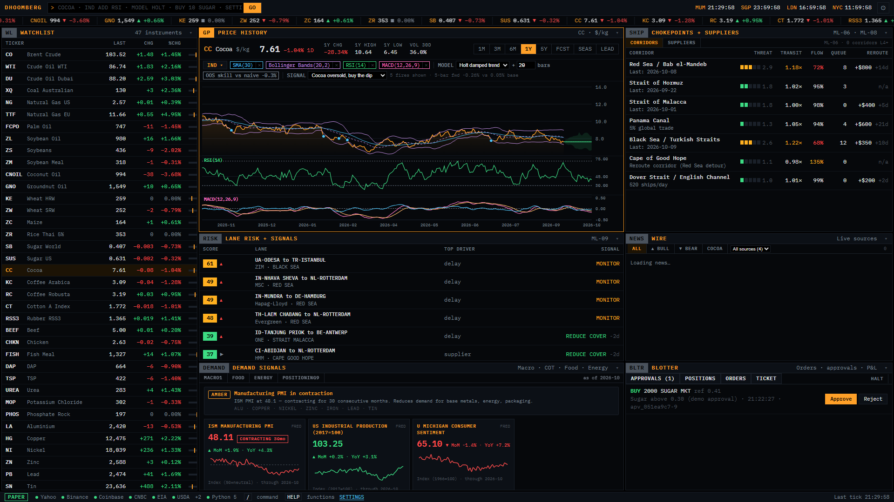
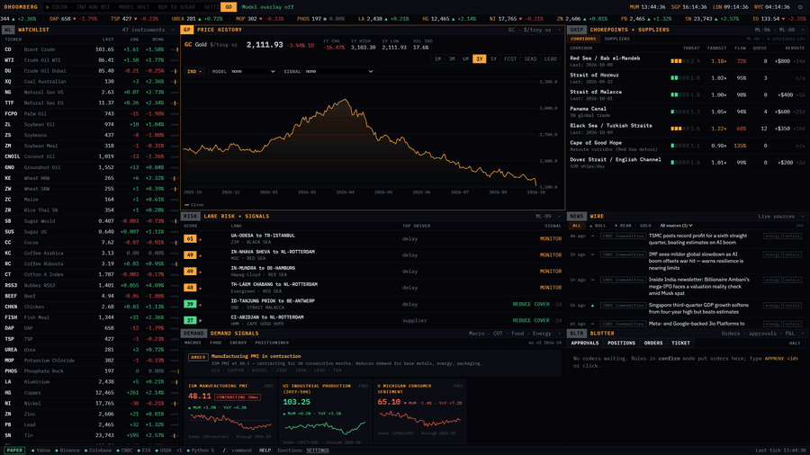
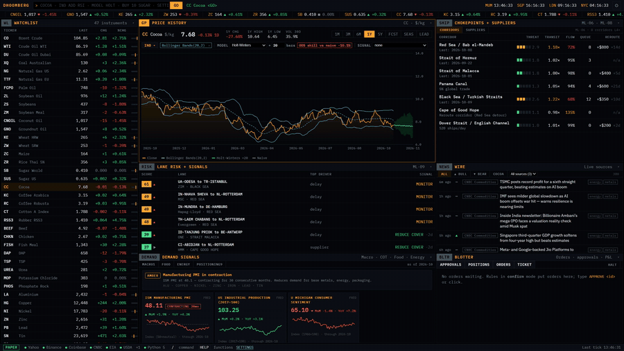
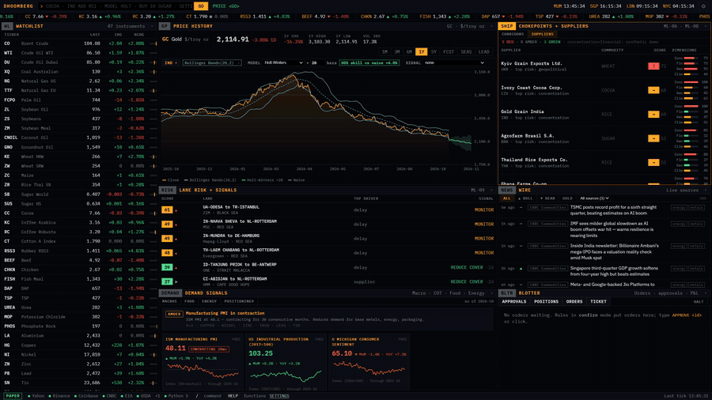
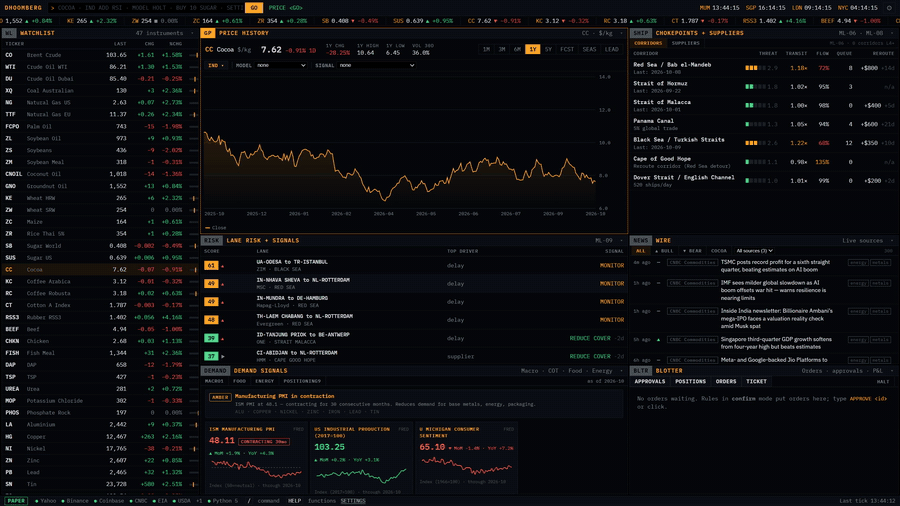

# Dhoomberg

A commodity intelligence terminal for FMCG and supply chain teams. Runs entirely on your machine. No SaaS subscription, no data leaving your network.



**[Watch the 73-second demo](docs/assets/demo.mp4)**

---

## See it work

**Pick a model, and see how it scores against the naive baseline.** The skill badge is always shown, even when it's negative.



**Turn a signal into an order.** Rules go through the risk guard, then wait for your approval in the blotter.



**Bring your own algorithms.** Drop a Python file in `plugins/` and it shows up in the dropdowns.



**Drive everything from the command bar.**



---

## What it does

- **46 commodity markets** tracked live: agricultural (grains, softs, edible oils), energy, metals, livestock
- **Price charts** with 15 built-in indicators (SMA, EMA, Bollinger, RSI, MACD, GARCH vol, Kalman trend…) and your own Python indicators
- **Forecasting:** 6 built-in time-series models + any Anthropic/OpenAI-compatible LLM + your own HTTP model endpoint. Every forecast is scored against the naive baseline; a model is never shown without its out-of-sample skill.
- **Shipping risk** panel: lane-level threat scores, corridor health, and supplier concentration across 6 major shipping lanes
- **Demand signals:** ISM PMI, industrial production, consumer sentiment, COT positioning, food-security alerts
- **News wire:** merged and sentiment-tagged feed from any RSS source plus 10 API presets (CNBC, USDA, EIA, Alpha Vantage, NewsAPI, Finnhub…)
- **Rules engine:** build alerts in a visual no-code builder or Python, backtested against real history. Rules can notify you, write to Sheets/Slack/ERPs, or place broker orders.
- **Order execution:** paper trading built in; Alpaca, OANDA, Tradovate and IBKR behind a pre-trade risk guard
- **Plugin system:** drop a `.py` file into `plugins/` and your indicator, model, signal or data source appears in every dropdown

---

## Quick start

### Requirements

| Runtime | Version |
|---|---|
| Node.js | ≥ 22.13 |
| Python | ≥ 3.10 |
| npm | ≥ 10 |

```bash
git clone https://github.com/Thebrownkidd/dhoomberg
cd dhoomberg
npm install
pip install -r requirements.txt
npm start
```

Open **http://localhost:5173**. The terminal loads in demo mode with simulated prices so you can explore everything without any API keys.

> **Python plugins are optional.** If you skip `pip install`, Python indicators simply won't appear. The rest of the terminal works.

### Adding real data

Press **SETTINGS** (or the ⚙ icon) → **Data Sources** → pick a preset or connect a generic REST/CSV/WebSocket source.

Yahoo Finance (unofficial, no key) is the easiest start:

1. Click **Connect** under *Yahoo Finance*
2. Click **Test** — it should show the date range of BZ=F (Brent)
3. In the terminal: `SOURCE BRENT YAHOO:BZ=F` — Brent now uses live Yahoo data

---

## Architecture

```
browser (React + Vite, port 5173)
  │  /api  (token header injected by Vite proxy in dev,
  │         SameSite cookie in production)
  ▼
server/ (Node 22, Fastify, 127.0.0.1:8787)
  ├─ vault         AES-256-GCM secrets, never returned to browser
  ├─ registry      plugin manifests + JSON-Schema config → settings UI
  ├─ connectors    datasource · news · model · action · broker
  ├─ rules engine  signal eval → notify / approve / order
  ├─ order guard   risk limits · kill switch · audit log
  ├─ SQLite        config, rules, ledger, audit (append-only)
  └─ py-bridge ──NDJSON over stdio──▶ Python worker → plugins/*.py
```

The server binds to `127.0.0.1` only and is **not reachable from your network**. All `/api` requests require a per-install token. Secrets are AES-256-GCM encrypted at rest.

Without the server, the terminal falls back to simulated prices — useful for demos and CI.

---

## Writing a plugin

Drop a Python file in the `plugins/` folder. The server reloads it automatically.

### Indicator

```python
from dhoomberg_runtime import indicator
import numpy as np

@indicator(
    name="kalman",
    title="Kalman trend",
    params={"q_ratio": 0.01},
    pane="overlay",          # or "sub"
    description="Local-level Kalman filter; smoother than SMA, less lag",
)
def kalman(series, q_ratio):
    # series is a pandas Series of closing prices
    x = series.to_numpy(dtype=float)
    r = np.nanvar(np.diff(x)) or 1.0
    q = r * float(q_ratio)
    est, p = x[0], 1.0
    out = np.empty_like(x)
    for i, z in enumerate(x):
        p += q
        k = p / (p + r)
        est += k * (z - est)
        p *= 1 - k
        out[i] = est
    return out
```

### Model (returns a forecast)

```python
from dhoomberg_runtime import model
import pandas as pd

@model(name="theta", title="Theta model", params={"horizon": 20})
def theta(series, horizon):
    # Return {values, lower, upper} — lower/upper are optional 80 % bands
    n = int(horizon)
    last = series.iloc[-1]
    slope = (series.iloc[-1] - series.iloc[0]) / len(series)
    vals = [last + slope * (i + 1) for i in range(n)]
    return {"values": vals}
```

### Signal (returns true/false for each bar)

```python
from dhoomberg_runtime import signal

@signal(name="n_bar_break", title="N-bar breakout", params={"n": 20, "direction": "up"})
def n_bar_break(series, n, direction):
    n = int(n)
    rolling_max = series.rolling(n).max()
    rolling_min = series.rolling(n).min()
    if direction == "up":
        return series > rolling_max.shift(1)
    return series < rolling_min.shift(1)
```

### Data source

```python
from dhoomberg_runtime import datasource
import pandas as pd

@datasource(
    name="warehouse_csv",
    title="Warehouse price CSV",
    params={"file_path": "plugins/examples/data/warehouse_prices.csv"},
)
def warehouse_csv(symbol, from_date, to_date, file_path):
    df = pd.read_csv(file_path, parse_dates=["date"], index_col="date")
    col = df[symbol] if symbol in df.columns else df.iloc[:, 0]
    col = col[(col.index >= pd.Timestamp(from_date)) & (col.index <= pd.Timestamp(to_date))]
    return col.rename("close").reset_index().rename(columns={"date": "time"}).to_dict("records")
```

Five complete examples are in [`plugins/examples/`](plugins/examples/).

---

## Commands

Type any command in the bar at the top and press **GO** (or Enter).

### Navigation

| Command | Description |
|---|---|
| `SUGAR` / `BRENT` / `CC` … | Switch to any commodity by ticker or name |
| `WL` | Focus the watchlist |
| `SETTINGS [tab]` | Open settings (optional: `data`, `news`, `models`, `rules`, `brokers`, `keys`) |

### Chart and analysis

| Command | Description |
|---|---|
| `IND ADD RSI 14` | Add an indicator with parameters |
| `IND ADD BBANDS 20 2` | Bollinger Bands, period 20, 2 σ |
| `IND REMOVE RSI` | Remove one indicator |
| `IND CLEAR` | Remove all indicators |
| `MODEL HOLT 20` | Holt damped-trend forecast, 20 bars ahead |
| `MODEL OFF` | Hide the forecast overlay |
| `COMPARE BRENT WTI` | Dual normalised chart |
| `BACKTEST <rule-name>` | Plot a rule's historical fires on the chart |

### Alerts and rules

| Command | Description |
|---|---|
| `ALERT BRENT BELOW 70` | Create a price threshold alert |
| `ALERT SUGAR ABOVE 600 NOTIFY` | Alert + browser push notification |
| `ALERTS` | List all active alerts |
| `ALERT CLEAR ALL` | Remove all alerts |
| `RULE NEW` | Open the rule builder |
| `RULES` | List all rules |

### Orders

| Command | Description |
|---|---|
| `BUY 100 COCOA` | Market buy on the paper broker |
| `SELL 50 BRENT LMT 72.50` | Limit sell |
| `BUY 10 GOLD ON alpaca` | Route to a specific broker |
| `APPROVE apv_abc123` | Approve a pending confirm-mode order |
| `REJECT apv_abc123` | Reject it |
| `APPROVALS` | List pending approvals |
| `HALT` | Kill switch: cancel all orders, block new ones |
| `RESUME` | Re-enable after HALT |
| `BLOTTER` | Show orders, positions and P&L |

### Data and export

| Command | Description |
|---|---|
| `SOURCE BRENT YAHOO:BZ=F` | Point an instrument at a connection |
| `CONNECT <plugin>` | Open the connection form for a plugin |
| `EXPORT COCOA 1Y CSV` | Download price history as CSV |
| `EXPORT COCOA 6M JSON` | Download as JSON |
| `WATCH WHEAT` | Add to watchlist |
| `UNWATCH WHEAT` | Remove from watchlist |
| `REFRESH` | Force re-fetch from all sources |

### Integrations and notifications

| Command | Description |
|---|---|
| `NOTIFY BRENT BELOW 70` | One-time browser push notification |
| `SET SLACK https://hooks.slack.com/…` | Store a Slack webhook in the vault |
| `HELP` | Show full command reference |

---

## Data sources

### Presets (no adapter code needed)

| Source | What you get | Key required |
|---|---|---|
| **Yahoo Finance** (unofficial) | 1-min to daily OHLCV, most assets | No |
| **Binance** | Spot crypto, real-time | No |
| **Coinbase Exchange** | Spot crypto, real-time | No |
| **FRED** (St. Louis Fed) | 800k+ macro series | Yes — [free](https://fred.stlouisfed.org/docs/api/api_key.html) |
| **EIA** | Petroleum, gas, power, coal | Yes — [free](https://www.eia.gov/opendata/) |
| **USDA QuickStats** | Crop and livestock statistics | Yes — [free](https://quickstats.nass.usda.gov/api) |
| **Alpha Vantage** | Commodities + equities (daily) | Yes — [free tier](https://www.alphavantage.co/support/#api-key) |
| **Twelve Data** | Stocks, ETFs, FX, crypto (real-time) | Yes |
| **Polygon.io** | US stocks, options, FX, crypto | Yes |
| **Nasdaq Data Link** | Quandl datasets | Yes |
| **Tiingo** | EOD prices and news | Yes |
| **Databento** | Futures and options (real-time) | Yes |
| **OANDA** | FX and CFD pricing | Yes |
| **IBKR** | Stocks, futures, options (via Client Portal) | Yes |

### Generic adapters (any API, no new code)

- **REST / JSON / NDJSON / CSV** — URL template, any auth type, JSONPath field mapping
- **CSV upload or URL** — each column becomes an instrument
- **WebSocket stream** — subscribe message template, JSONPath price/symbol/time paths
- **Python `@datasource`** — write a function in `plugins/`

---

## Settings

All settings live in the **Settings** page (⚙ or `SETTINGS`):

| Tab | What you configure |
|---|---|
| **Data Sources** | Connect and test data feeds |
| **Instruments** | Add custom symbols, change units, re-point to a feed |
| **News** | RSS feeds, API news sources, sentiment thresholds |
| **Models** | LLM providers, custom HTTP model endpoints |
| **Indicators & Python** | View discovered Python plugins, file errors |
| **Signals & Rules** | Build, test, backtest and enable rules |
| **Actions & Integrations** | Slack, email, Sheets, ERP, webhooks |
| **Brokers & Risk** | Paper/live broker setup, risk limits, kill switch |
| **Keys** | Named API-key store (vault-encrypted) |
| **Workspace** | Panel layout, theme |
| **Import / Export** | Back up and restore config (secrets excluded) |
| **Audit Log** | Every order, rule fire, approval and config change |

### Risk limits (default values)

| Limit | Default |
|---|---|
| Max order notional | $10,000 |
| Max daily notional | $50,000 |
| Max orders per day | 20 |
| Max position per instrument | $25,000 |
| Limit price band from last | 2% |
| Max quote age | 300 s |

All limits can be changed in **Settings → Brokers & Risk**.

### Live trading

Brokers default to paper/demo mode. To place real orders:

1. Set the broker's environment to **live** in its connection form.
2. In **Brokers & Risk → Brokers**, click **Arm live trading** and retype your account ID.
3. In the rule or ticket, set execution mode to **auto** (rules) or just submit (ticket).

Only real-time data sources can trigger live orders. Yahoo Finance, Alpha Vantage daily, and other delayed sources are blocked.

---

## Running in production

```bash
npm run serve
```

This builds the frontend and serves it from the Node server (`127.0.0.1:8787`). The token is set as a `SameSite=Strict` cookie instead of a header. Point a reverse proxy (nginx, Caddy) at port 8787 if you want HTTPS; the server itself does not do TLS.

**Master key:** on first run the server writes `.dhoomberg/master.key` (64 random hex bytes). Back this up. If you lose it, all stored secrets become unreadable.

**Environment variables:**

| Variable | Description |
|---|---|
| `DHOOMBERG_MASTER_KEY` | 64-hex-char key (overrides the file) |
| `DHOOMBERG_DATA_DIR` | Where `.dhoomberg/` is created (default: cwd) |
| `DHOOMBERG_PORT` | Server port (default: 8787) |

---

## Tests

```bash
npm test
```

100 tests across 7 suites:

| Suite | What it covers |
|---|---|
| `indicators.test.ts` | 6 indicators vs TA-Lib reference values (tolerance 1e-9) |
| `models.test.ts` | All 6 built-in models, OOS skill vs naive |
| `guard.test.ts` | 26 order-guard cases (every limit + midnight-crossing market hours) |
| `datasource.test.ts` | Response parsers for all supported formats |
| `server.test.ts` | Auth (5 attack vectors), vault, paper trading flow, HALT, audit triggers |
| `pybridge.test.ts` | Plugin discovery, all 4 plugin kinds, timeout recovery, crash recovery |
| `rules.test.ts` | Rule operators, crosses detection, backtest result shape |

Indicator reference values were generated with TA-Lib and are stored in `tests/fixtures/`. To regenerate them (requires TA-Lib installed):

```bash
python tests/fixtures/gen_talib.py
```

---

## Project layout

```
dhoomberg/
├─ src/               React frontend (Vite)
│   ├─ components/    PriceChart, NewsFeed, Blotter, SchemaForm…
│   ├─ pages/         Settings tabs
│   └─ lib/           API client, server health, chart config
├─ server/            Node 22 + Fastify backend
│   ├─ plugins/       Connector implementations (datasource, news, model, action, broker)
│   ├─ orders/        Guard, executor, paper ledger
│   ├─ rules/         Engine, backtest
│   ├─ vault.ts       AES-256-GCM secret store
│   ├─ db.ts          SQLite schema + helpers
│   └─ auth.ts        Token + 5-layer request validation
├─ shared/            Types and pure functions used by both sides
│   ├─ types.ts       Plugin, rule, order, instrument types
│   ├─ indicators.ts  Pure TS indicator functions
│   └─ models.ts      Built-in forecasters + OOS evaluator
├─ dhoomberg_runtime/ Python SDK (decorators for plugin files)
├─ plugins/           Your plugin files go here
│   └─ examples/      Five example plugins
├─ tests/             Vitest test suites + fixtures
├─ docs/              Functional requirement docs, ML reports
├─ research/          Data-fetch and ML-pipeline scripts (Python)
└─ public/            Static assets served by Vite
```

---

## Contributing

See [CONTRIBUTING.md](CONTRIBUTING.md).

The key constraints:

- **ML rigor:** every model must be scored against the naive baseline using rolling-origin out-of-sample evaluation. Do not display a model without its baseline skill. Do not claim an edge without proving it holds in the second half of the dataset.
- **Order safety:** every change to `server/orders/guard.ts` requires a corresponding test in `tests/guard.test.ts` proving the new limit actually rejects.
- **Secrets:** nothing encrypted can appear in any API response. The test suite scans every response for this; do not disable the scan.
- **Server scope:** the browser side must not make direct calls to third-party APIs. All external calls go through the server.

---

## License

MIT — see [LICENSE](LICENSE).
